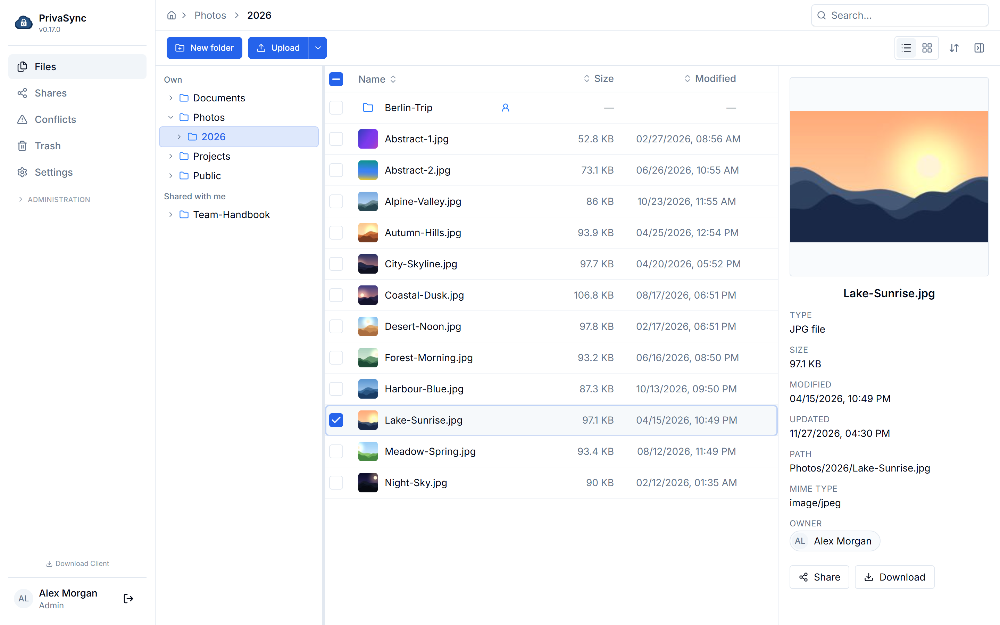
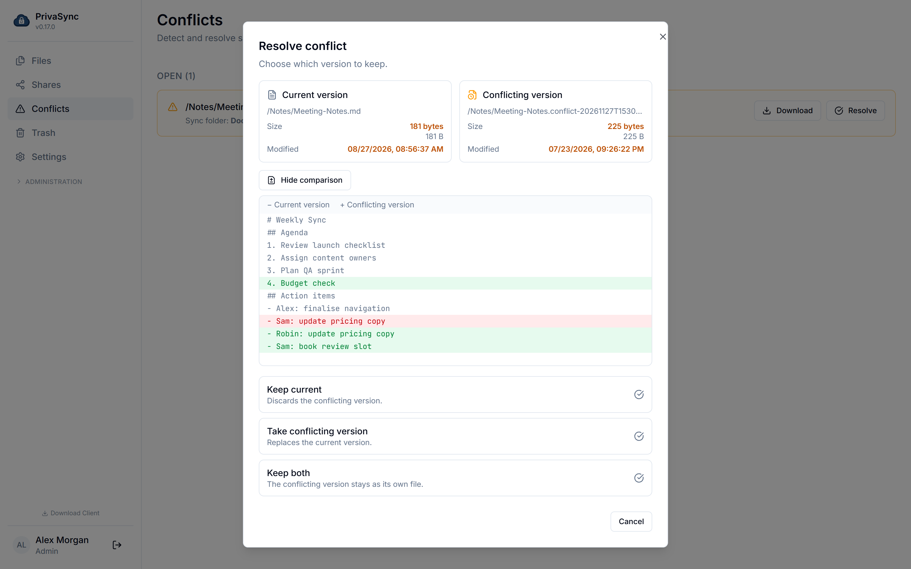
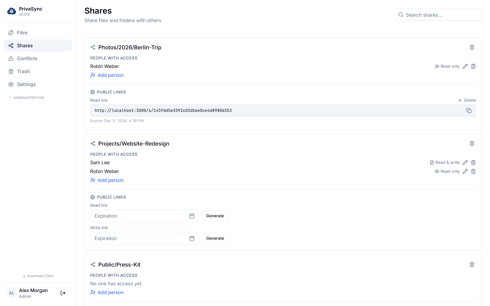
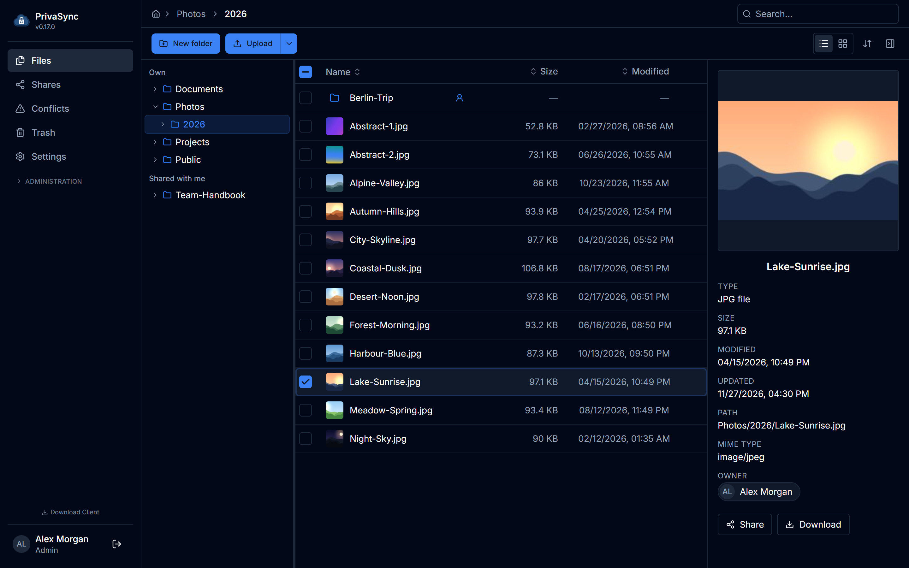
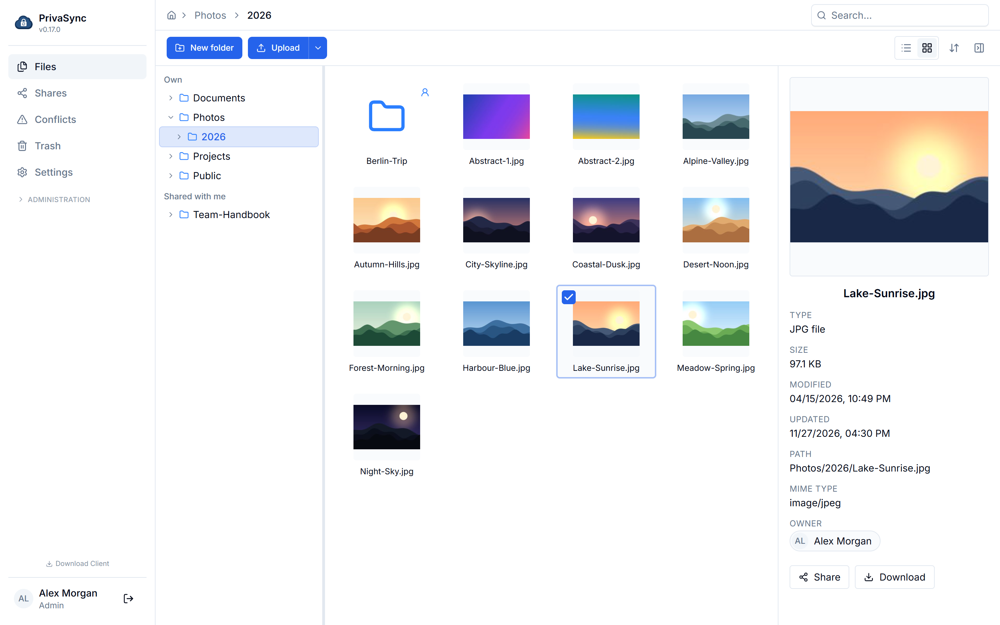
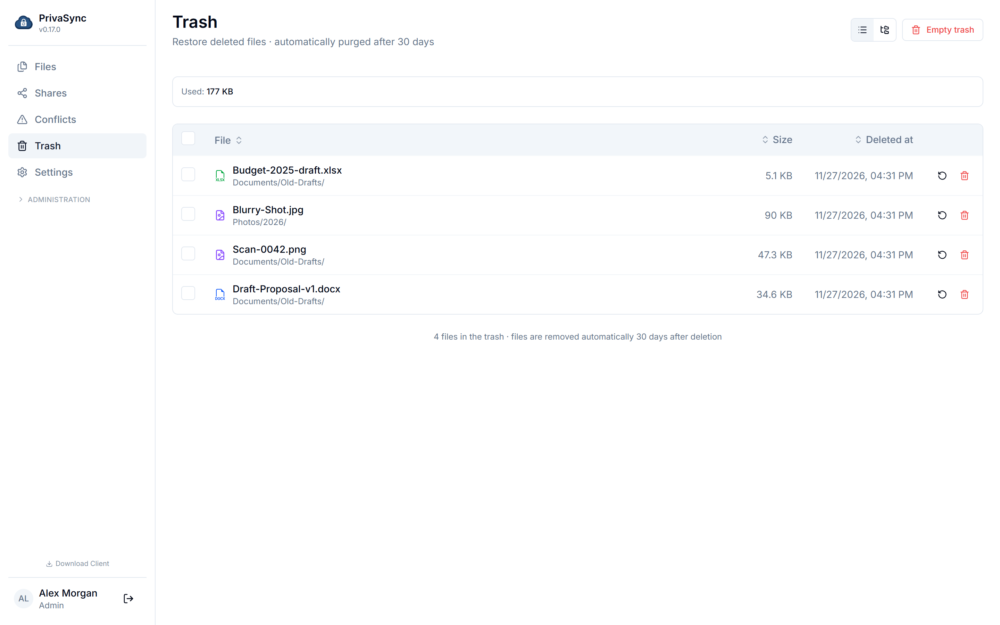
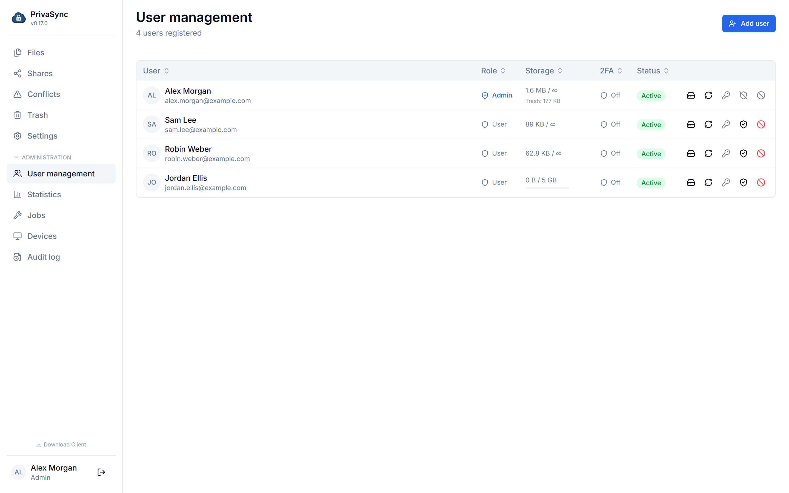
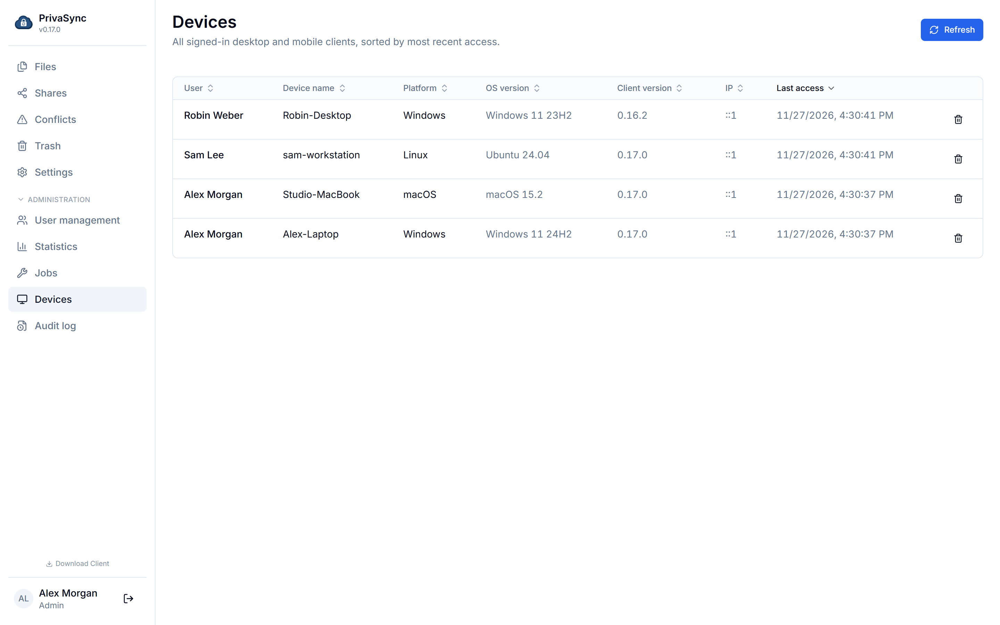
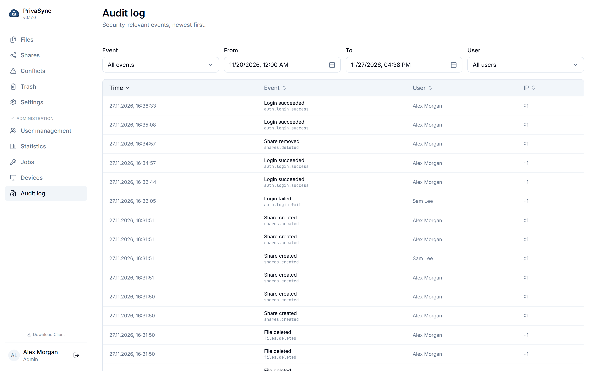

# PrivaSync

Self-hosted file sync for individuals and small teams, with a Go server, a React web UI and a Tauri desktop client that supports Windows Cloud Files placeholders.

[](https://github.com/Jeansy91/priva-sync/actions/workflows/ci.yml)
[](LICENSE)
[](https://ko-fi.com/jeansy91)

PrivaSync mirrors your files between several clients and one central server. The server stores files as plain files on disk, so you can browse them directly on the host. PostgreSQL only holds the index and metadata and can be rebuilt from the data directory. Correctness comes before speed: no data loss, not even on conflicts.

## Features

- Bidirectional sync between the server and any number of desktop clients, with a custom sync engine written in Rust
- Delta sync with BLAKE3 and chunked, resumable uploads for large files
- Conflicts are never overwritten: the losing version is kept as a copy and can be resolved in the web UI
- Windows Cloud Files placeholders: files appear in Explorer and are downloaded on demand
- Web UI for browsing, uploading, searching, previewing and managing files
- Trash that counts toward the user quota, with restore
- Public share links (optional password and expiry) and shares with other users (read or read and write)
- Optional office document preview and editing through an external OnlyOffice-compatible document server
- WebDAV access for rclone, Windows Explorer and other WebDAV clients, using per-device app passwords
- Sign-in with TOTP two-factor authentication (with backup codes) or passkeys (WebAuthn)
- Admin area: users, quotas, audit log, devices and background jobs
- E-mail notifications through your own SMTP server (opt-in)
- Desktop clients update themselves with signed updates; the server always offers the client version that matches its own
- Web UI in German and English

## Screenshots



| Conflict resolution | Shares |
|---|---|
|  |  |
| **Dark mode** | **Grid view** |
|  |  |

<details>
<summary>More: trash, user management, devices, audit log</summary>






</details>

## Architecture

PrivaSync is a monorepo. See [docs/architecture.md](docs/architecture.md) for the full overview.

| Path | Component | Technology |
|---|---|---|
| [`apps/server`](apps/server) | Server: REST API, WebDAV, sync engine | Go, chi, PostgreSQL |
| [`apps/web`](apps/web) | Web UI | React, TypeScript, Vite |
| [`apps/desktop`](apps/desktop) | Desktop client | Tauri 2 (Rust and React) |
| [`packages/api-client`](packages/api-client) | Typed API bindings shared by web and desktop | TypeScript |
| [`packages/ui`](packages/ui) | Shared UI components and design tokens | React, Tailwind CSS |
| [`packages/i18n`](packages/i18n) | Shared translations | TypeScript |

```
Desktop (Tauri) ─┐
Browser (React) ─┼── REST + SSE ──► Server (Go) ──► PostgreSQL (index, metadata)
rclone / WebDAV ─┘                       └────────► /data (plain files)
```

## Quick start

### Docker Compose (recommended)

A ready-made server image, including the web UI, is published to the GitHub Container Registry on every release: `ghcr.io/jeansy91/privasync-server`.

1. Get [`docker-compose.yml`](docker-compose.yml) and [`.env.example`](.env.example) from this repository and replace the `build:` block of the `server` service with the published image:

   ```yaml
   image: ghcr.io/jeansy91/privasync-server:latest
   ```

   Instead of `latest` you can pin a version. All versions are listed under [Releases](https://github.com/Jeansy91/priva-sync/releases).

2. Create a `.env` file from `.env.example` and set the two required variables:

   | Variable | Description |
   |---|---|
   | `DB_PASSWORD` | Password of the PostgreSQL database |
   | `JWT_SECRET` | Secret for signing tokens, at least 32 characters (`openssl rand -hex 32`) |

3. Prepare the data directories and start the stack. The container runs as the fixed non-root user 10001:

   ```bash
   mkdir -p ./data ./config && chown -R 10001:10001 ./data ./config
   docker compose up -d
   ```

The web UI and the REST API run on `http://localhost:8080`, WebDAV on port `8081`. Set `BASE_URL` and `CORS_ORIGINS` to the public URL of your instance, for example `https://sync.example.com`, and run PrivaSync behind a TLS-terminating reverse proxy.

Settings come from environment variables or from a mounted `config/config.yaml` (template: [`apps/server/config.example.yaml`](apps/server/config.example.yaml)). Environment variables follow the format `PRIVASYNC_<SECTION>__<FIELD>`, with **one** underscore after `PRIVASYNC` and a double underscore between levels. For example `server.base_url` becomes `PRIVASYNC_SERVER__BASE_URL` and `database.url` becomes `PRIVASYNC_DATABASE__URL`. Environment variables win over the config file.

> **Run exactly one server instance.** `--scale server=2` is not supported: tokens live in process memory, the SSE hub is process-local and the outbox relies on a single worker. A second instance causes broken downloads, missing live updates and duplicate e-mails. See [ADR-0039](docs/adr/0039-single-server-instance.md).

> **Behind a reverse proxy, set `TRUSTED_PROXIES`.** Otherwise the server sees every user under the proxy address and rate limit, login lockout and audit log lose their meaning.

More on configuration, reverse proxy, WebDAV and the optional office preview: [docs/deployment.md](docs/deployment.md).

### Desktop client

Download the client for your system from the [Releases](https://github.com/Jeansy91/priva-sync/releases) page:

- **Windows (x86_64):** `privasync-windows-x86_64-setup.exe`
- **Linux (x86_64):** `privasync-linux-x86_64.AppImage` (make it executable and run it)
- **macOS (Apple Silicon / Intel):** `privasync-darwin-aarch64.dmg` / `privasync-darwin-x86_64.dmg`

Start the client, enter the URL of your server and sign in. The client then updates itself: your server offers the client version that matches its own and points the updater at the GitHub release. This only works while the GitHub repository is public, because the downloads are anonymous.

The builds are not signed with a paid code-signing certificate, so Windows SmartScreen may warn on first start: choose "More info", then "Run anyway". The macOS builds are not notarized either: open the app via right click, "Open". Updates are verified with an Ed25519 signature before they are installed. Background in [docs/releasing.md](docs/releasing.md).

## Development

Requirements: Go, Node.js with pnpm, the Rust toolchain (for the desktop client) and PostgreSQL.

```bash
pnpm install
cp .env.example .env     # set DB_HOST, DB_PASSWORD and JWT_SECRET
make dev-server          # Go server
make dev-web             # Vite dev server
pnpm --filter @privasync/desktop tauri dev
```

Run the tests with `make test-server`, `pnpm --filter @privasync/web test`, `pnpm --filter @privasync/desktop test` and `cd apps/desktop/src-tauri && cargo test`. `make help` lists all targets. The full guide, including coverage gates, is in [docs/development.md](docs/development.md).

## Documentation

- [Documentation index](docs/README.md)
- [Architecture overview](docs/architecture.md) and [specification](SPEC.md)
- [Architecture Decision Records](docs/adr/README.md): **design decisions and their reasoning are written down here**, one record per decision
- [Deployment](docs/deployment.md), [development](docs/development.md) and [releasing](docs/releasing.md)
- [Glossary](docs/glossary.md)

The technical documentation is written in German. Code comments are in English.

## Contributing

Contributions are welcome. Please read [CONTRIBUTING.md](CONTRIBUTING.md) first.

## Security

Please report vulnerabilities privately, not in a public issue. See [SECURITY.md](SECURITY.md).

## License

PrivaSync is free software under the [GNU Affero General Public License v3.0](LICENSE). If you run a modified version for other people, for example as a hosted service, you have to offer them your modified source code.

## Support

If you like PrivaSync, you can support its development on [Ko-fi](https://ko-fi.com/jeansy91).
